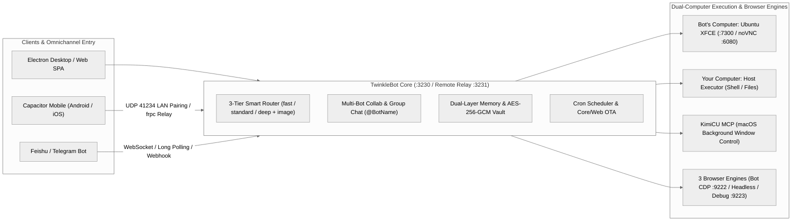

<div align="center">


<h1>TwinkleBot</h1>

<p><strong>Cross-Platform Multi-Bot AI Desktop &amp; Mobile Agent</strong></p>

<p>An AI agent workspace combining an isolated sandbox computer, a host execution bridge, 3-tier smart routing, and omnichannel access</p>

<p>
  <a href="https://github.com/caixy-plus/twinklebot/releases/latest"></a>
  <a href="https://github.com/caixy-plus/twinklebot/actions/workflows/ci.yml"></a>
  =22.13" />
  
  <br />
  <a href="https://github.com/caixy-plus/twinklebot/stargazers"></a>
  <a href="LICENSE"></a>
  
</p>

<p>
  <strong>English</strong> ·
  <a href="README.zh-CN.md">简体中文</a>
</p>

<p>
  <a href="#key-capabilities">Key Capabilities</a> ·
  <a href="#downloads--installation">Downloads &amp; Installation</a> ·
  <a href="#quick-start">Quick Start</a> ·
  <a href="#architecture">Architecture</a> ·
  <a href="#developer-reference">Developer Reference</a> ·
  <a href="#security--privacy-redlines">Security Redlines</a>
</p>

</div>

---

## Key Capabilities

TwinkleBot is built around **multi-agent collaboration**, **dual-computer execution surfaces**, and **seamless cross-device reach**, covering end-to-end workflows from local desktop automation to mobile remote control and IM bots:

| Dimension | Features & Architecture |
| :--- | :--- |
| **Multi-Bot & Group Collaboration** | Ships with an admin Bot (`Twinkle`) plus customizable specialized Bots (13 shapes × 11 colors avatars, isolated workspace / memory / library); supports `bot_manage` (including clone-with-memory), `create_bot`, `list_bots`, `send_bot_message` (`MAX_BOT_HOPS=8`), `workspace_search`, and `library_manage`. Group chats (`type: "group"`) support `@BotName` longest-prefix matching, reply-priority routing, and role-relevance scoring (`MAX_GROUP_TURNS=3` per turn). **Dual-layer memory** maintains both Bot-private and global shared memories with silent async extraction. |
| **Live Steering & 6 Interactive Cards** | Supports non-blocking mid-turn redirection (**Live Steering**), natural-language stop detection (`stop-detector`), 60-step pause & resume, hover/click reply & text-selection quote, in-place user message edit & resend (synchronously truncating DOM / NDJSON / history), and up to 3 attachments (≤ 10 MB each). Includes **6 inline interactive cards**: `ask_user_choice` (`1–6` / `A–F` hotkeys), `propose_draft`, `request_credential`, `ApprovalCard` (inline permission rule editor), `MarkupPreviewCard` (sandboxed HTML/SVG live preview with 3 background/viewport toggles), and `send_file` (workspace/download card). |
| **Dual Computers + 3 Browser Engines + KimiCU** | **Bot's Computer**: Ubuntu XFCE `:1` (1440×900) backed by macOS **OrbStack**, Windows **WSL2 Ubuntu**, or cloud Linux (`executor.py` `:7300`, noVNC `:6080`); CLI, file, and GUI tools inside the sandbox auto-allow by default, with a built-in **Bot's Computer** pane supporting **Take Control** and a concurrent screen pool, plus `computer_provision` and `system_diagnostics`.<br>**Your Computer (Host Executor)**: `host_run_shell` (zsh / UTF-8 PowerShell), `host_open`, `host_read_file`, and `host_write_file`, strictly governed by `Always Allow / Ask Every Time / Never Allow` policies.<br>**KimiCU MCP (macOS only)**: Launches `/Applications/KimiCU.app/Contents/MacOS/kimi-cu` with live tool and capability self-discovery for background, cursor-safe window screenshots, AX tree inspection, and keyboard/mouse automation.<br>**3 Chrome Engines**: Bot Chrome CDP (`:9222`, shared login state), Host Chrome Headless (clean profile, low CPU), and Host Chrome Debug (`:9223`). |
| **3-Tier Smart Routing & Multi-Currency Billing** | Smart `fast` / `standard` / `deep` + `image` tiered routing with L1 planning, dynamic tier escalation, and error cooldowns (`60s` on 402/429/503/504, permanent isolation on 404); includes `economy` / `balanced` / `quality` presets and `maxTurnUsd` budget caps. Built-in drivers for `gemini` (`@google/genai` >=2.29.1 Interactions API, plus keyless GCP Vertex AI when `DEPLOY_ENV=cloud`), `openai`, `deepseek`, and `openai-compatible` (accepting raw API keys or env var names); `USD` / `CNY` usage converts uniformly to `¥` (`USD_TO_CNY=7.25`) with balance calibration. |
| **Omnichannel Access, Remote Relay & IM Bots** | Unified **Local Account / Cloud Account** model.<br>**Mobile (Capacitor Android / iOS + Mobile Web)**: `dist-web/` physically strips backend code and secrets; supports UDP `41234` (`TWINKLEBOT_DISCOVER_V1`) LAN auto-discovery + 6-digit pairing codes (5-min TTL, 5-attempt lockout) exchanged for a permanent device token; native QR scanner (Android `PortraitCaptureActivity` / iOS `AVCaptureSession`), disconnected gate, portrait lock with auto-landscape remote desktop, and virtual remote keyboard toggle.<br>**Remote Relay (`remote-relay-v1`)**: Desktop **Settings → Remote Relay** starts a strict-auth relay on `127.0.0.1:3231` (Bearer / `?token=` exchanged for an `HttpOnly` Cookie, with self-config endpoints locked), supporting built-in managed `frpc` (WSS/TCP/QUIC + `caffeinate` sleep prevention) or external proxies, generating `twinklebot://...` QR codes and VPS `frps.toml` / `Caddyfile` snippets. Cloud mode (`DEPLOY_ENV=cloud`) returns `ok` on `/`.<br>**Feishu & Telegram**: Multi-account `feishu-bot` (`@larksuiteoapi/node-sdk`, WebSocket / Webhook) and `telegram-bot` (`grammy`, Long Polling + HTTP/SOCKS5 proxy / Webhook) with in-chat setup (`skill_configure_channel`) and 6-digit pairing management (`channel_pairing_manage`), **sharing session history and `memories` across Desktop / Mobile / Web / Feishu / Telegram**, and automatically delivering files from `send_file` / `generate_image` (Telegram ≤ 50 MB, Feishu ≤ 30 MB). |
| **Skill Ecosystem, Encrypted Vault & Cron Scheduling** | **7 non-removable core built-in skills** (`desktop-control`, `shell-and-files`, `ai-image` with SVG fallback, `multi-bot-collab`, `interactive-cards`, `custom-skill-manager`, `websearch` DuckDuckGo→Bing + `web_fetch`) + **5 store-installable skills** (`kimi-cu`, `feishu-bot`, `telegram-bot`, `qqmail` 16-char auth code, `custom-mail` multi-account IMAP/POP3/SMTP). Supports `custom_skill_manage` for global or per-Bot `SKILL.md`, standard 5-field Cron scheduling (`schedule_manage`), and an **AES-256-GCM** encrypted credential vault (OS Keychain / DPAPI / keyfile) that exposes only opaque `secret_ref` tokens to models. |
| **Core + Web OTA Hot Updates** | Backed by `version-policy.json` (`v1.0.7`, Android/iOS `buildCode: 8`, 14 `apiCapabilities`) with strict `v1.0.5+` shell-version binding checks. Desktop Core OTA hot-updates `server-bundle.mjs`, Web static assets, `executor.py`, and prompts/knowledge; Mobile Web OTA hot-updates `dist-web/`. Supports `self_update` (`status` / `check` / `apply` / `rollback` to `previous` / `builtin`), queued cleanly after active turns with Watchdog auto-rollback; shell versions strictly follow `PATCH 0–9` / `MINOR 0–19` rollover rules. |

---

## Downloads & Installation

Prebuilt desktop installers and signed Android APKs are published on [GitHub Releases](https://github.com/caixy-plus/twinklebot/releases):

| Platform | Artifacts | Download |
| :--- | :--- | :--- |
| **macOS** (Apple Silicon / Intel) | `.dmg` / `.zip` | [Latest Release](https://github.com/caixy-plus/twinklebot/releases/latest) |
| **Windows** (x64) | `.exe` (NSIS Installer) / `.zip` | [Latest Release](https://github.com/caixy-plus/twinklebot/releases/latest) |
| **Linux** (x64) | `.AppImage` / `.tar.gz` | [Latest Release](https://github.com/caixy-plus/twinklebot/releases/latest) |
| **Android** | Signed `.apk` | [Latest Release](https://github.com/caixy-plus/twinklebot/releases/latest) |
| **All Releases & OTA** | Full platform installers / `ota-channel` | [All Releases](https://github.com/caixy-plus/twinklebot/releases) |

---

## Quick Start

### Option 1: Installers (Recommended for Desktop / Mobile)

1. Download and install the package for your platform from [Latest Release](https://github.com/caixy-plus/twinklebot/releases/latest).
2. On first launch, enter your model API key (or environment variable name) in the onboarding flow or **Settings → Models & Routing** to start chatting.
3. To enable **Bot's Computer** (Ubuntu XFCE sandbox desktop), use **OrbStack** on macOS or **WSL2 Ubuntu** on Windows, then run `computer_provision` in chat to provision the sandbox and browser in one click.

### Option 2: Run from Source & CLI Mode (Node.js >= 22.13)

```bash
# 1. Clone the repository and install dependencies
git clone https://github.com/caixy-plus/twinklebot.git
cd twinklebot
npm install

# 2. (Optional) Deploy the Ubuntu sandbox executor (generates TWINKLEBOT_EXECUTOR_TOKEN and starts twinklebot-executor.service)
./scripts/deploy-executor.sh

# 3. Compile TypeScript & frontend assets and start the local server (listens on http://127.0.0.1:3230)
npm start

# Or run a single task in interactive CLI mode (supports stdin [y/N] approvals)
npm run cli -- "Describe your task here"
```

> [!TIP]
> - Besides manual provisioning via `./scripts/deploy-executor.sh`, you can call `computer_provision` directly in chat to install `xdotool`, `wmctrl`, `xclip`, `imagemagick`, Google Chrome / Chromium, `Xtigervnc`/`x11vnc`, noVNC (`:6080`), and CJK fonts inside the Ubuntu XFCE `:1` (`1440×900`) sandbox.
> - Model keys can either live in root `.env` (e.g. `GEMINI_API_KEY`) or be configured directly in the UI under **Settings → Models & Routing**.

---

## Architecture



---

## Developer Reference

<details>
<summary><b>Directory Layout (TypeScript Monorepo)</b></summary>

```text
twinklebot/
├── src/
│   ├── shared/              # Shared types, DTOs & browser-safe modules (accounts-store / skills-catalog / versioning)
│   ├── server/              # HTTP / WebSocket server (index.ts, context.ts, http-utils.ts, static.ts, routes/*.ts)
│   ├── agent/               # Agent loop, smart router, context compression, policy, providers/*.ts, bot-tools/*.ts, prompts/, knowledge/
│   ├── store/               # Atomic persistence for sessions (.json/.ndjson/.history.json), skills, Cron schedules, vault (under data/)
│   ├── lib/                 # LAN discovery, pairing auth, remote relay, Feishu/Telegram channels, mail, MCP, web search, billing & host bridge
│   ├── electron/            # Electron main process, Core OTA, tray & backend supervisor (backend-supervisor.ts / core-ota.ts)
│   ├── web/                 # React 19 + Vite SPA frontend (main.tsx, ssr-entry.tsx, components/, hooks/, services/, state/, styles/)
│   ├── cli/                 # Interactive CLI runner (index.ts)
│   └── landing/             # Official landing page source
├── electron/                # Electron preload scripts & tray page (preload.cjs, tray-preload.cjs, tray.html)
├── public/                  # Static assets, stylesheets & compiled frontend bundles (public/dist/)
├── executor/                # Ubuntu sandbox executor daemon (Python 3 stdlib only, port 7300) & Python unit tests
├── android/ & ios/          # Capacitor native projects (Android LanDiscoveryPlugin / PortraitCaptureActivity, etc.)
├── scripts/                 # Build, Core/Web OTA packaging, version sync, sandbox provisioning & E2E runner scripts
├── test/                    # Unit/integration tests & tiered E2E suites (test/e2e/)
├── .agents/skills/twinklebot-e2e/  # Tiered E2E specification, catalog.json & coverage audit scripts
└── version-policy.json      # Single source of truth for shell versions, OTA minimum bounds & API Capabilities
```

</details>

<details>
<summary><b>Build, Packaging &amp; Core + Web OTA</b></summary>

```bash
# Typecheck and full build (dist-server/ + core-runtime + public/dist/ + landing/dist/)
npm run typecheck
npm run build:ts
npm run build:ota            # Generates twinklebot-core-desktop.tar.gz and twinklebot-web-mobile.tar.gz

# Desktop development & packaging (Electron)
npm run electron:dev         # Build and launch Electron locally
npm run electron:pack:mac    # macOS unpacked app directory
npm run electron:pack:win    # Windows unpacked app directory
npm run electron:pack:linux  # Linux unpacked app directory
npm run electron:dist:mac    # macOS dmg / zip installers
npm run electron:dist:win    # Windows NSIS / zip installers
npm run electron:dist:linux  # Linux AppImage / tar.gz installers

# Mobile build (strips backend/secrets into dist-web/ and syncs Capacitor)
npm run mobile:build:web
npm run mobile:sync:android
npm run mobile:apk:debug
npm run mobile:apk:release

# Synchronize native shell versions (only when native shell layers change; PATCH 0-9 / MINOR 0-19)
npm run version:bump -- --dry-run
```

</details>

<details>
<summary><b>Testing &amp; Tiered E2E Suite (14 Suites / 110 Cases)</b></summary>

TwinkleBot includes 74 unit/integration test files, Python sandbox executor unit tests, and a tiered E2E suite spanning **P0–P3 (14 suites / 110 atomic cases**: `P0: 21`, `P1: 47`, `P2: 30`, `P3: 12`) using headless Chrome and offline loopback fixtures by default:

```bash
# Unit & integration tests
npm test                     # Compile TS and run all node --test suites
npm run test:py              # Run executor/ Python unit tests (or orb -m ubuntu python3 -m unittest discover -s executor -v)
npm run test:integration     # Run test:py + test + test:e2e:chrome sequentially

# Tiered E2E & coverage audits
npm run test:e2e:list        # List all 14 suites and 110 cases
npm run test:e2e:p0          # Core smoke & security baseline (21 cases)
npm run test:e2e:p1          # Collab, cards, sandbox, routing & mobile flows (47 cases)
npm run test:e2e:p2          # CLI, landing page, settings & hotkeys (30 cases)
npm run test:e2e:p3          # Tray chaos recovery & live-network smoke (12 cases)
npm run test:e2e:all         # All 110 cases
npm run test:e2e:affected    # Auto-select suites based on git diff impact
npm run test:e2e:release     # Pre-release gate: affected + P0
npm run e2e:sync-check       # Verify code changes vs E2E catalog sync
npm run e2e:audit            # 6-dimension 100% static coverage audit
npm run e2e:report           # Generate standardized Markdown diagnostic report
```

</details>

---

## Security & Privacy Redlines

> [!IMPORTANT]
> - **Network & Auth Isolation**: The web server binds to loopback `127.0.0.1:3230` by default; the remote relay (`:3231`) enforces authentication (Bearer / `?token=` exchanged for an `HttpOnly` Cookie) and locks self-configuration endpoints; the Ubuntu executor (`:7300`) requires a Bearer Token; LAN and IM 6-digit pairing codes lock after 5 consecutive failures; cloud mode (`DEPLOY_ENV=cloud`) serves pure API with `ok` on `/`.
> - **Dual-Computer Tiered Approval**: CLI, file, and GUI operations inside **Bot's Computer** sandbox auto-allow by default, whereas host actions (**Your Computer** `host_*` tools), cross-workspace writes, and dangerous commands/piped scripts are strictly governed by `Always Allow / Ask Every Time / Never Allow` policies and explicit user approval.
> - **Dual-Layer Sensitive Path Blocking**: Both the policy engine and execution layer block reads, writes, and exfiltration targeting `.ssh`, `.aws`, `.gnupg`, `Library/Keychains`, `chrome-debug-profile`, `.env*`, `*credentials*`, `*secret*`, `*token*`, `vault.json`, system directories, and shell startup scripts.
> - **Zero-Leak Vault & Runtime Guards**: Credentials are encrypted with **AES-256-GCM** in `vault.json`; models only see opaque `secret_ref` placeholders (`{{secret:cred_...}}`), unwrapped solely inside controlled `browser_type` / `type_text` injections and never exposed to LLMs, shells, or URLs. `web_fetch` blocks private/cloud-metadata IPs against SSRF, MCP child processes strip sensitive environment variables (`SCRUBBED_ENV_KEYS`), untrusted screen/web/email text is isolated against prompt injection, and execution enforces a `60`-step task limit and `120s` per-command shell timeout.

---

## Community & License

- Feedback & bug reports: [GitHub Issues](https://github.com/caixy-plus/twinklebot/issues) · Releases: [Releases](https://github.com/caixy-plus/twinklebot/releases) · Discussions: [Discussions](https://github.com/caixy-plus/twinklebot/discussions)
- Issues and Pull Requests are welcome! Before submitting, please make sure `npm run typecheck`, `npm test`, and `npm run e2e:audit` pass.

<a href="https://www.star-history.com/#caixy-plus/twinklebot&Date">
  <picture>
    <source media="(prefers-color-scheme: dark)" srcset="https://api.star-history.com/svg?repos=caixy-plus/twinklebot&type=Date&theme=dark" />
    <source media="(prefers-color-scheme: light)" srcset="https://api.star-history.com/svg?repos=caixy-plus/twinklebot&type=Date" />
    
  </picture>
</a>

Licensed under the [MIT License](LICENSE).
