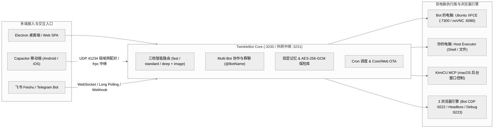

<div align="center">


<h1>TwinkleBot</h1>

<p><strong>Cross-Platform Multi-Bot AI Desktop &amp; Mobile Agent</strong></p>

<p>跨平台多 Bot 协同 AI 桌面与移动智能体 —— 融合专属沙箱电脑、宿主机执行桥、三档智能路由与全渠道触达</p>

<p>
  <a href="https://github.com/caixy-plus/twinklebot/releases/latest"></a>
  <a href="https://github.com/caixy-plus/twinklebot/actions/workflows/ci.yml"></a>
  =22.13" />
  
  <br />
  <a href="https://github.com/caixy-plus/twinklebot/stargazers"></a>
  <a href="LICENSE"></a>
  
</p>

<p>
  <a href="README.md">English</a> ·
  <strong>简体中文</strong>
</p>

<p>
  <a href="#核心能力">核心能力</a> ·
  <a href="#下载与安装">下载与安装</a> ·
  <a href="#快速上手">快速上手</a> ·
  <a href="#系统架构">系统架构</a> ·
  <a href="#开发者参考">开发者参考</a> ·
  <a href="#安全与隐私红线">安全红线</a>
</p>

</div>

---

## 核心能力

TwinkleBot 围绕**多智能体协作**、**双电脑执行面**与**跨端无缝触达**构建，覆盖从个人桌面自动化到移动远程遥控与 IM 机器人接入的完整工作流：

| 能力维度 | 核心特性与机制 |
| :--- | :--- |
| **Multi-Bot 与群聊协作** | 内置主控 Bot（`Twinkle`）与多位可定制专属 Bot（13 种形状 × 11 种配色头像，独立工作区 / 记忆 / 资料库）；支持 `bot_manage`（含带记忆克隆）、`create_bot`、`list_bots`、`send_bot_message`（最大跳数 `MAX_BOT_HOPS=8`）、`workspace_search` 与 `library_manage`。群聊（`type: "group"`）支持 `@BotName` 最长前缀匹配、回复优先路由与角色相关性评分（单轮最多 `MAX_GROUP_TURNS=3`）。**双层记忆**兼顾 Bot 专属记忆与全局共享记忆，并支持静默异步提取。 |
| **实时插话与 6 种交互卡片** | 支持运行中无中断实时插话转向（**Live Steering**）、自然语言停止检测（`stop-detector`）、60 步上限暂停续跑、悬停/点击回复与划词引用、用户消息就地修改重发（同步截断 DOM / NDJSON / 历史），以及最多 3 个附件（单个 ≤ 10 MB）。内置 **6 种内联交互卡片**：`ask_user_choice`（支持 `1–6` / `A–F` 快捷键）、`propose_draft`、`request_credential`、`ApprovalCard`（内联权限规则编辑器）、`MarkupPreviewCard`（沙箱 HTML/SVG 实时预览与 3 种背景/视口切换）、`send_file`（工作区/下载卡片）。 |
| **双电脑 + 3 浏览器引擎 + KimiCU** | **Bot 的电脑**：Ubuntu XFCE `:1`（1440×900），支持 macOS **OrbStack**、Windows **WSL2 Ubuntu** 或云端 Linux（`executor.py` `:7300`，noVNC `:6080`）；沙箱内 CLI / 文件 / GUI 默认自动放行，内置「Bot 的电脑」面板支持**「取得控制权」**人工接管与并发屏幕池，支持 `computer_provision` 自动部署与 `system_diagnostics`。<br>**你的电脑（Host Executor）**：`host_run_shell`（zsh / UTF-8 PowerShell）、`host_open`、`host_read_file`、`host_write_file`，由 `始终允许 / 每次询问 / 从不允许` 策略严格管控。<br>**KimiCU MCP（macOS 专属）**：通过 `/Applications/KimiCU.app/Contents/MacOS/kimi-cu` 自动发现工具列表与版本能力，实现不抢占物理鼠标光标的后台窗口截图、AX 树读取与键鼠控制。<br>**3 种 Chrome 引擎**：Bot Chrome CDP（`:9222`，共享登录态）、Host Chrome Headless（空白配置、低 CPU 占用）、Host Chrome Debug（`:9223`）。 |
| **三档智能路由与多币种计费** | `fast` / `standard` / `deep` + `image` 智能分级路由，内置 L1 路由规划、动态升档与异常冷却（402/429/503/504 冷却 `60s`，404 永久隔离）；提供 `economy` / `balanced` / `quality` 预设与 `maxTurnUsd` 单轮预算限制。内置 `gemini`（基于 `@google/genai` >=2.29.1 Interactions API，云端 `DEPLOY_ENV=cloud` 支持免密钥 GCP Vertex AI）、`openai`、`deepseek`、`openai-compatible` 驱动（支持填写密钥或环境变量名）；`USD` / `CNY` 多币种计费统一折算为 `¥`（`USD_TO_CNY=7.25`）并支持余额校准。 |
| **全渠道连接、外网中继与 IM Bot** | 统一采用**「本地账号 / 云端账号」**模型。<br>**移动端（Capacitor Android / iOS + Mobile Web）**：构建产物 `dist-web/` 物理剥离服务端与敏感配置；支持 UDP `41234`（`TWINKLEBOT_DISCOVER_V1`）局域网自动发现 + 6 位配对码（5 分钟有效、5 次失败锁定）换取永久设备令牌；支持原生二维码扫描（Android `PortraitCaptureActivity` / iOS `AVCaptureSession`）、断连门禁页，以及竖屏锁定 + 远程桌面自动横屏与远程键盘切换。<br>**外网中继（`remote-relay-v1`）**：桌面端「设置 → 外网中继」在 `127.0.0.1:3231` 启动强鉴权中继（Bearer / `?token=` 换取 `HttpOnly` Cookie，中继端口锁定自配置），支持内置托管 `frpc`（WSS/TCP/QUIC，`caffeinate` 防休眠）或外置代理，可生成 `twinklebot://...` 二维码及 VPS `frps.toml` / `Caddyfile`。云端模式 `DEPLOY_ENV=cloud` 根路径 `/` 返回 `ok`。<br>**飞书 & Telegram**：多账号 `feishu-bot`（`@larksuiteoapi/node-sdk`，WebSocket / Webhook）与 `telegram-bot`（`grammy`，Long Polling + HTTP/SOCKS5 代理 / Webhook），支持对话内配置（`skill_configure_channel`）与 6 位配对码管理（`channel_pairing_manage`），**跨 Desktop / Mobile / Web / 飞书 / Telegram 共享会话历史与 `memories`**，并自动完成 `send_file` / `generate_image` 文件直发（Telegram ≤ 50 MB，飞书 ≤ 30 MB）。 |
| **技能生态、保险库与定时调度** | **7 个不可移除核心内置技能**（`desktop-control`、`shell-and-files`、`ai-image` 含 SVG 回退、`multi-bot-collab`、`interactive-cards`、`custom-skill-manager`、`websearch` DuckDuckGo→Bing + `web_fetch`）+ **5 个商店可安装技能**（`kimi-cu`、`feishu-bot`、`telegram-bot`、`qqmail` 16 位授权码、`custom-mail` IMAP/POP3/SMTP 多账号）。支持 `custom_skill_manage` 管理全局或单 Bot 自定义 `SKILL.md`、标准 5 字段 Cron 调度（`schedule_manage`），以及基于 **AES-256-GCM**（OS Keychain / DPAPI / 密钥文件）的加密保险库（仅向模型返回不透明引用 `secret_ref`）。 |
| **Core + Web OTA 热更新** | 依托 `version-policy.json`（`v1.0.7`，Android/iOS `buildCode: 8`，14 项 `apiCapabilities`）实现 `v1.0.5+` 严格壳版本绑定校验。桌面端 Core OTA 热更新 `server-bundle.mjs`、Web 静态资源、`executor.py` 与提示词/知识库；移动端 Web OTA 热更新 `dist-web/`。支持 `self_update`（`status` / `check` / `apply` / `rollback` 至 `previous` / `builtin`），在活跃轮次完成后排队生效并配备 Watchdog 自动回滚；版本号严格遵循 `PATCH 0–9` / `MINOR 0–19` 进位规则。 |

---

## 下载与安装

预编译桌面端安装包与 Android APK 均发布于 [GitHub Releases](https://github.com/caixy-plus/twinklebot/releases)：

| 平台 | 产物格式 | 下载入口 |
| :--- | :--- | :--- |
| **macOS**（Apple Silicon / Intel） | `.dmg` / `.zip` | [Latest Release](https://github.com/caixy-plus/twinklebot/releases/latest) |
| **Windows**（x64） | `.exe`（NSIS 安装器）/ `.zip` | [Latest Release](https://github.com/caixy-plus/twinklebot/releases/latest) |
| **Linux**（x64） | `.AppImage` / `.tar.gz` | [Latest Release](https://github.com/caixy-plus/twinklebot/releases/latest) |
| **Android** | 正式签名 `.apk` | [Latest Release](https://github.com/caixy-plus/twinklebot/releases/latest) |
| **全部历史版本与 OTA** | 全平台安装包 / `ota-channel` | [All Releases](https://github.com/caixy-plus/twinklebot/releases) |

---

## 快速上手

### 方式一：安装包直接启动（推荐桌面 / 移动用户）

1. 从 [Latest Release](https://github.com/caixy-plus/twinklebot/releases/latest) 下载并安装对应平台的应用。
2. 首次打开后，在引导流程或「设置 → 模型接入与路由」中填写模型密钥（或环境变量名），即可开始对话。
3. 如需启用 **Bot 的电脑**（Ubuntu XFCE 沙箱桌面），macOS 可配合 **OrbStack**、Windows 可配合 **WSL2 Ubuntu**，并在应用内通过 `computer_provision` 一键部署沙箱环境与浏览器。

### 方式二：源码运行与 CLI 模式（Node.js >= 22.13）

```bash
# 1. 克隆仓库并安装依赖
git clone https://github.com/caixy-plus/twinklebot.git
cd twinklebot
npm install

# 2. （可选）部署 Ubuntu 沙箱执行器（生成 TWINKLEBOT_EXECUTOR_TOKEN 并启动 twinklebot-executor.service）
./scripts/deploy-executor.sh

# 3. 编译 TypeScript 与前端资源并启动本地服务（默认监听 http://127.0.0.1:3230）
npm start

# 或使用命令行模式单次执行任务（支持 stdin [y/N] 交互审批）
npm run cli -- "你的任务描述"
```

> [!TIP]
> - 沙箱环境（Ubuntu XFCE `:1`，1440×900）除通过 `./scripts/deploy-executor.sh` 手动部署外，也可直接在对话中调用 `computer_provision` 自动完成 `xdotool`、`wmctrl`、`xclip`、`imagemagick`、Google Chrome / Chromium、`Xtigervnc`/`x11vnc`、noVNC（`:6080`）与中文字体配置。
> - 模型密钥既可写入根目录 `.env`（如 `GEMINI_API_KEY`），也可启动后在界面「设置 → 模型接入与路由」中直接配置。

---

## 系统架构



---

## 开发者参考

<details>
<summary><b>目录结构（TypeScript Monorepo）</b></summary>

```text
twinklebot/
├── src/
│   ├── shared/              # 前后端共享类型、DTO 与浏览器安全模块（accounts-store / skills-catalog / versioning）
│   ├── server/              # HTTP / WebSocket 服务端（index.ts、context.ts、http-utils.ts、static.ts、routes/*.ts）
│   ├── agent/               # Agent 执行循环、智能路由、上下文压缩、策略、providers/*.ts、bot-tools/*.ts、prompts/、knowledge/
│   ├── store/               # 会话（.json/.ndjson/.history.json）、技能、Cron 日程、保险库原子持久化（写入 data/）
│   ├── lib/                 # LAN 发现、配对鉴权、外网中继、飞书/Telegram 渠道、邮件、MCP、网页搜索、计费与宿主机桥接
│   ├── electron/            # Electron 主进程、Core OTA、托盘与后台监管（backend-supervisor.ts / core-ota.ts）
│   ├── web/                 # React 19 + Vite SPA 前端（main.tsx、ssr-entry.tsx、components/、hooks/、services/、state/、styles/）
│   ├── cli/                 # 命令行交互执行入口（index.ts）
│   └── landing/             # 官网展示页源码
├── electron/                # Electron 预加载脚本与托盘页面（preload.cjs、tray-preload.cjs、tray.html）
├── public/                  # 静态资源、样式与编译输出（public/dist/）
├── executor/                # Ubuntu 沙箱执行守护脚本（仅依赖 Python 3 标准库，监听 7300 端口）与 Python 单测
├── android/ & ios/          # Capacitor 原生工程（Android LanDiscoveryPlugin / PortraitCaptureActivity 等）
├── scripts/                 # 构建、Core/Web OTA 打包、版本号同步、沙箱部署与 E2E 运行脚本
├── test/                    # 单元/集成测试与分层 E2E 测试套件（test/e2e/）
├── .agents/skills/twinklebot-e2e/  # 分层 E2E 规范、catalog.json 与覆盖率审计脚本
└── version-policy.json      # 壳版本、OTA 最低版本策略与 API Capabilities 单一真源
```

</details>

<details>
<summary><b>构建、打包与 Core + Web OTA</b></summary>

```bash
# 类型检查与全量构建（dist-server/ + core-runtime + public/dist/ + landing/dist/）
npm run typecheck
npm run build:ts
npm run build:ota            # 生成 twinklebot-core-desktop.tar.gz 与 twinklebot-web-mobile.tar.gz

# 桌面端开发与打包（Electron）
npm run electron:dev         # 构建并本地启动 Electron
npm run electron:pack:mac    # macOS 免签名目录包
npm run electron:pack:win    # Windows 免安装目录包
npm run electron:pack:linux  # Linux 免安装目录包
npm run electron:dist:mac    # macOS dmg / zip 安装包
npm run electron:dist:win    # Windows NSIS / zip 安装包
npm run electron:dist:linux  # Linux AppImage / tar.gz 安装包

# 移动端构建（剥离服务端与敏感文件至 dist-web/ 并同步 Capacitor）
npm run mobile:build:web
npm run mobile:sync:android
npm run mobile:apk:debug
npm run mobile:apk:release

# 统一同步版本号（仅需升级原生壳版本时使用，PATCH 0-9 / MINOR 0-19）
npm run version:bump -- --dry-run
```

</details>

<details>
<summary><b>测试与分层 E2E 体系（14 套件 / 110 用例）</b></summary>

TwinkleBot 内置 74 个单元/集成测试文件、Python 沙箱执行器单测，以及覆盖 **P0–P3 共 14 个套件 / 110 个原子用例**（`P0: 21`、`P1: 47`、`P2: 30`、`P3: 12`）的分层 E2E 体系（默认 headless Chrome + 离线回环固件）：

```bash
# 单元与集成测试
npm test                     # 编译并运行全部 node --test 用例
npm run test:py              # 运行 executor/ Python 单元测试（或 orb -m ubuntu python3 -m unittest discover -s executor -v）
npm run test:integration     # 串联执行 test:py + test + test:e2e:chrome

# 分层 E2E 与覆盖率审计
npm run test:e2e:list        # 查看全部 14 个套件与 110 个用例清单
npm run test:e2e:p0          # 核心冒烟与安全底线（21 用例）
npm run test:e2e:p1          # 协作、卡片、沙箱、路由与移动端交互（47 用例）
npm run test:e2e:p2          # CLI、官网、设置与快捷键（30 用例）
npm run test:e2e:p3          # 托盘混沌恢复与实网冒烟（12 用例）
npm run test:e2e:all         # 全量 110 用例
npm run test:e2e:affected    # 基于 git 变更影响面自动筛选运行
npm run test:e2e:release     # 发布前 affected + P0 回归门禁
npm run e2e:sync-check       # 检查代码改动与 E2E 目录同步状态
npm run e2e:audit            # 6 维度 100% 静态覆盖率审计
npm run e2e:report           # 生成标准 Markdown 测试诊断报告
```

</details>

---

## 安全与隐私红线

> [!IMPORTANT]
> - **网络与鉴权隔离**：Web 服务默认仅绑定回环地址 `127.0.0.1:3230`；外网中继 `:3231` 强制鉴权（Bearer / `?token=` 换取 `HttpOnly` Cookie）并锁定自身配置接口；Ubuntu 执行器 `:7300` 强制 Bearer Token；LAN 与 IM 渠道 6 位配对码连续失败 5 次即锁定；云端模式 `DEPLOY_ENV=cloud` 根路径仅响应 `ok` 纯 API。
> - **双电脑分级审批**：沙箱环境（**Bot 的电脑**）内 CLI、文件与 GUI 默认自动放行；宿主机（**你的电脑** `host_*` 工具）与跨工作区写操作、高危命令/管道脚本受 `始终允许 / 每次询问 / 从不允许` 策略与用户审批严格约束。
> - **敏感路径双重拦截**：`.ssh`、`.aws`、`.gnupg`、`Library/Keychains`、`chrome-debug-profile`、`.env*`、`*credentials*`、`*secret*`、`*token*`、`vault.json` 及系统目录/Shell 启动脚本在策略层与执行层双重拒绝读写与外发。
> - **零泄漏保险库与运行时防护**：凭据由 **AES-256-GCM** 加密存储于 `vault.json`，模型侧仅见不透明引用 `secret_ref`（`{{secret:cred_...}}`），仅在受控 `browser_type` / `type_text` 时解封注入，绝不暴露给 LLM、Shell 或 URL；`web_fetch` 拦截内网与云元数据 IP 防止 SSRF；MCP 子进程自动剥离敏感环境变量（`SCRUBBED_ENV_KEYS`）；系统严格隔离不可信屏幕/网页/邮件内容以防御提示注入，并限制单任务最高 `60` 步与单条 Shell `120s` 超时。

---

## 社区与开源协议

- 问题反馈与建议：[GitHub Issues](https://github.com/caixy-plus/twinklebot/issues) · 版本发布记录：[Releases](https://github.com/caixy-plus/twinklebot/releases) · 交流讨论：[Discussions](https://github.com/caixy-plus/twinklebot/discussions)
- 欢迎通过 Issue 与 Pull Request 参与贡献；提交前请确保 `npm run typecheck`、`npm test` 与 `npm run e2e:audit` 通过。

<a href="https://www.star-history.com/#caixy-plus/twinklebot&Date">
  <picture>
    <source media="(prefers-color-scheme: dark)" srcset="https://api.star-history.com/svg?repos=caixy-plus/twinklebot&type=Date&theme=dark" />
    <source media="(prefers-color-scheme: light)" srcset="https://api.star-history.com/svg?repos=caixy-plus/twinklebot&type=Date" />
    
  </picture>
</a>

基于 [MIT License](LICENSE) 开源。
