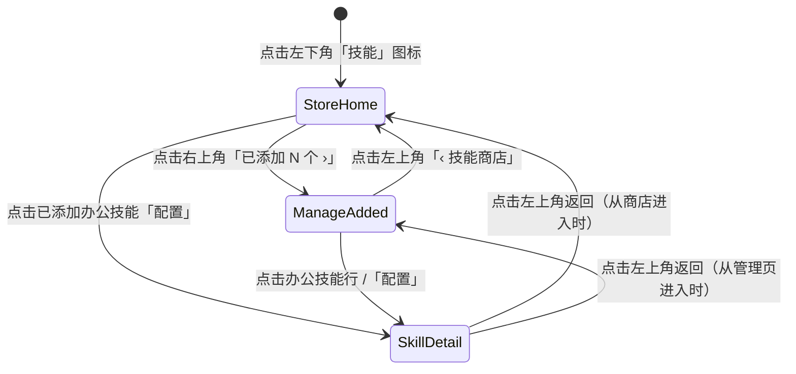

# TwinkleBot 统一技能商店与 GrokBot 风格交互设计方案

日期：2026-11-11

## 1. 背景与设计意图（Intent & Why）

此前左下角「连接应用」存在三个核心体验问题：
1. **概念割裂**：同时存在「连接应用」与「私有技能」，二级页还重复列出邮箱状态；
2. **表单压迫感强**：首屏直接平铺 6～10 个输入框的大表单，0 账号时出现双重空状态，多账号时浏览与新增互相干扰；
3. **缺乏对话式配置能力**：无法直接在聊天中让 Bot 查看或修改已添加技能的配置。

本次重构全面对齐 **GrokBot（`com.anysphere.sand`）** 的弹窗层级、双列无框行卡片与对话内联交互范式，将能力体系收拢为统一的 **「技能 / 技能商店（Skills Store）」**：
- **统一命名与入口**：所有能力统称 **技能（Skill）**，左下角入口统一进入 **技能商店**；
- **三大技能分类与生命周期**：
  - **平台技能（`platform`）**：系统核心内置能力（共 5 项），常驻开启，**不可关闭、不可移除**（对标 GrokBot「已安装」中的 `Superpowers · N 项技能` 无卸载按钮形态）；
  - **办公技能（`office`）**：包含 **QQ 邮箱**（`qqmail`）与 **通用邮箱**（`custom-mail`，支持 POP3 / IMAP + SMTP 多账号），遵循 **「先添加 → 再配置 → 可移除」**，且 **应用默认已添加这两个邮箱技能**；
  - **自定义技能（`custom`）**：用户自建的指令型技能（原 `privateSkills`），支持新建、启停与移除；
- **GrokBot 式对话配置**：直接通过自然语言操作**已添加**技能的配置（查状态、新增多个邮箱账号、改备注/协议/服务器、设默认、测连通性、删单个账号；未提供密码时在聊天流内弹出 GrokBot 风格加密掩码卡片安全采集，绝不明文落盘或回显）。

---

## 2. 目标、非目标与反目标（Goals / Non-Goals / Anti-Goals）

### Goals
- 左下角按钮（`#connect-apps-btn` 与紧凑窄轨 `#compact-apps-btn`）统一为 **技能 / 技能商店** 入口，保持 GrokBot 左下角 `[账户头像]  [2×2 技能图标]` 布局。
- 弹窗交互严格复刻 GrokBot 的三层子视图切换（`技能商店主目录` ↔ `管理已添加技能` ↔ `单技能多账号配置页`），首屏清爽展示双列技能行，**绝不平铺邮箱长表单**。
- `settings.installedSkills` 未初始化时默认值为 `["qqmail", "custom-mail"]`，开箱即添加两个邮箱技能。
- 支持通过对话工具 `skill_list` 与 `skill_configure_mail` 直接操作已添加技能的配置，服务端对已移除技能实施硬门控拦截。

### Non-Goals
- 不引入外部第三方远程插件代码下载执行。
- 不新增 `@google/genai` 之外的任何 npm 运行时依赖。
- 不通过对话静默安装未添加的办公技能（添加/移除技能在技能商店完成，对话仅操作**已添加**技能的配置与收发信）。

### Anti-Goals（出现即视为失败）
- 平台技能出现关闭开关或移除按钮，或可通过 API 停用。
- 技能商店首页直接露出服务器/授权码输入框，或 0 账号时渲染空列表框。
- 邮箱密码 / 16 位授权码出现在聊天气泡历史、`/api/settings`、`/api/skills` 或前端日志中。
- 办公技能在技能商店移除后，Bot 仍可读取其邮件或通过对话修改其账号配置。

---

## 3. 约束条件（Constraints）

- **技术栈约束**：Node.js 22.13+，纯 ESM JavaScript，零新增运行时依赖；模型调用仅使用 `@google/genai` Interactions API。
- **安全约束**：邮箱凭据仅保存在 `0o600` 权限的 `data/mail-auth.json`，受 `agent/policy.js`（`/.*auth.*\.json$/i`）硬拦截；`mail_send_message` 继续默认经由 `draft_request` 草稿确认卡放行。
- **向后兼容**：无损兼容现有 `data/settings.json`（`privateSkills`）与 `data/mail-auth.json`（多账号 `accounts` 数组及旧版单账号结构）。

---

## 4. 架构方案（Selected Approach）

采用 **统一后端技能目录（`lib/skills-catalog.js`）+ 服务端动态工具门控 + 强类型对话配置工具**：
- 前后端共享同一套技能分类元数据与邮箱域名服务器预设字典；
- `server.js`、`agent/loop.js`、`agent/bot-tools.js` 根据 `settings.installedSkills` 实施服务端硬门控；
- `skill_configure_mail` 采用强类型参数 Schema，并在缺少密码/授权码时复用 GrokBot 内联 `credential_request` 掩码卡采集后直写 `mail-auth.json`，通过全局 SSE `{ type: "skills_updated" }` 实时同步前端。

---

## 5. 详细设计（Detailed Design）

### 5.1 技能目录与分类定义（`lib/skills-catalog.js`）

定义三种分类：
- `platform`（平台技能：`removable: false`, `configurable: false`）
- `office`（办公：`removable: true`, `configurable: true`, `defaultInstalled: true`）
- `custom`（自定义：`removable: true`, `configurable: true`）

内置技能清单：
1. **平台技能（`platform`，共 5 项，常驻不可关闭/不可移除）**：
   - `desktop-control`：**电脑桌面操控**（虚拟桌面截屏、键鼠点击拖拽、窗口控制与浏览器操作）
   - `shell-and-files`：**终端与文件读写**（沙盒与授权目录内执行命令、读写工作区文件）
   - `ai-image`：**AI 图像生成与重绘**（Nano Banana 2 / Pro 文生图与参考图重绘）
   - `multi-bot-collab`：**多 Bot 派生与群聊协作**（创建专职子 Bot、跨 Bot 委派与群聊协同）
   - `interactive-cards`：**交互提问与安全审批**（多选提问卡、发信草稿审核卡与加密凭据输入卡）
2. **办公技能（`office`，共 2 项，默认已添加 `installedSkills: ["qqmail", "custom-mail"]`）**：
   - `qqmail`：**QQ 邮箱**（支持绑定多个 QQ 邮箱 / Foxmail 账号，IMAP/POP3 收信 + SMTP 发信）
   - `custom-mail`：**通用邮箱**（支持通过 POP3 / IMAP + SMTP 绑定多个 163/126、腾讯企业邮、阿里邮、Outlook、飞书或自建邮局账号）

`resolveInstalledSkillIds(settings)` 规则：
- 当 `Array.isArray(settings?.installedSkills)` 时，过滤合法可安装技能 ID 并去重；
- 当 `settings?.installedSkills === undefined` 时，默认返回 `["qqmail", "custom-mail"]`。

### 5.2 通用邮箱域名智能预填（`inferMailServerPreset`）

输入 `user@<domain>` 时自动推导收发服务器（前后端共享）：
- 内置精确字典：`163.com`、`126.com`、`yeah.net`、`qq.com` / `foxmail.com`、`exmail.qq.com`、`aliyun.com`、`outlook.com` / `hotmail.com` / `live.com`（SMTP `587` `starttls`）、`gmail.com`、`feishu.cn`；
- 未知企业域名 `<domain>` 兜底：`imap.<domain>:993`（或 `pop.<domain>:995`）+ `smtp.<domain>:465` (`ssl`)；
- 前端保护手填值：仅在对应输入框未被用户手动编辑（`!input.dataset.userEdited`）时自动预填。

### 5.3 GrokBot 风格三层弹窗交互（`public/index.html`、`public/style.css`、`public/app.js`）

严格对标 GrokBot 原生弹窗结构（`780px` 圆角面板，无杂乱副标题，单窗口内无感切换三个子视图）：

1. **子视图 1：`技能商店` 主目录（对标 GrokBot `连接应用` 主视图）**
   - **第一行（Header）**：左侧大标题 `技能商店`；右侧为**重叠小图标徽章 + `已添加 N 个 ›` 胶囊按钮**（点击进入子视图 2）与右上角 `✕` 关闭按钮。
   - **第二行（搜索 + 模板）**：左侧圆角搜索框 `🔍 在技能中搜索`（实时过滤技能名称、简介与已绑邮箱）；右侧带吉祥物图标胶囊按钮 `Bot 模板 ↗`（一键创建专职「邮箱管家」Bot）。
   - **第三行（分类筛选胶囊）**：`全部`（选中态为高对比实心胶囊）| `办公` | `平台技能` | `自定义`。
   - **主体列表（GrokBot 双列清爽行卡片，40×40 圆角图标 + 名称与单行简述 + 右侧单胶囊动作）**：
     - **`办公` 分组**：
       - 未添加时：右侧显示胶囊按钮 **`添加`**（点击调用 `POST /api/skills/:id/install` 立即添加）；
       - 已添加时：副标题展示 `已配置 N 个账号`（0 账号时展示 `IMAP / POP3 + SMTP · 待配置`），右侧显示胶囊按钮 **`配置`**（点击进入子视图 3）。
     - **`平台技能` 分组**：展示 5 项平台内置能力（如 `电脑桌面操控 · 10 项工具`），右侧仅展示低调只读标签 **`内置`**，无任何关闭或移除入口。
     - **`自定义` 分组**：分组标题右侧带轻量 `+ 新建技能` 链接（对标 GrokBot 分组标题右侧 `查看全部` 位置），下方列出用户自定义技能。

2. **子视图 2：`管理已添加技能`（对标 GrokBot `< 连接应用 / 管理插件和技能`）**
   - **顶栏**：左上角 `< 技能商店` 返回按钮，下方主标题 `管理已添加技能`。
   - **`已添加` 双列网格**：
     - 列出当前已添加的**办公技能**（副标题显示 `N 个账号`，右侧显示绿色 `已添加` 状态与轻量 `配置` / `移除` 动作）以及 5 项**平台技能**（显示 `N 项工具 · 内置常驻`，无移除按钮，完全贴合 GrokBot `Superpowers · 14 项技能` 的呈现方式）。
     - 点击办公技能的 `移除` 时，在行下展开轻量内联确认条：`移除后 Bot 将暂停使用该技能` +（若有已存账号）可选复选框 `同时清除已保存的 N 个邮箱凭据` + `确认移除` / `取消`。
   - **`自定义技能` 单列列表**：圆角方形文档图标 + 加粗技能名 + 单行截断指令摘要 + 启停开关与删除按钮，支持右上角 `+ 新建技能` 内联创建。

3. **子视图 3：单个办公技能详情与多账号配置页（`< 技能商店` → `QQ 邮箱` 或 `通用邮箱`）**
   - **顶栏**：左上角 `< 技能商店`（返回上一级视图），右上角提供低调的 `移除技能` 按钮与 `✕`。
   - **多账号主从切换（消除空框与大表单干扰）**：
     - **当已有 ≥ 1 个账号且未处于编辑/新增态时**：清爽展示该技能下的账号列表行（邮箱地址、备注、`默认` 徽章、协议摘要，右侧仅保留 `设为默认`、`测试`、`编辑` 三个轻量按钮）+ 底部 `+ 添加邮箱账号` 按钮。
     - **当该技能有 0 个账号（首次点击「配置」进入），或点击了 `+ 添加邮箱账号` / `编辑` 时**：直接呈现聚焦单表单：
       - **QQ 邮箱表单（首屏免滚动）**：仅平铺 4 个核心项（`QQ 邮箱地址`、`16 位授权码`、`账号备注（可选）`、`设为默认收发邮箱`），`发件人昵称` 与 `收件协议 (IMAP / POP3)` 收纳入 `
` **`高级选项`**。
       - **通用邮箱表单（域名自动预填）**：输入邮箱后自动预填收发服务器、端口与加密方式（附提示 `已按邮箱域名填入推荐配置，可手动修改`），`发件人昵称` 收纳入 `
` **`高级选项`**。
       - **底部操作栏**：主胶囊按钮 `连接并保存`（或 `保存修改`，成功后回到账号列表或商店视图）、`测试连通性`、编辑已有账号时提供 `发测试信` 以及带二次确认（`移除此账号` → `确认移除？`）的账号删除按钮。

### 5.4 对话式技能配置与 GrokBot 内联卡片体验（`server.js`、`agent/bot-tools.js`、`agent/loop.js`、`agent/prompt.js`）

1. **服务端 API 与门控（`server.js`）**
   - `GET /api/skills` 与 `GET /api/settings` 统一返回 `installedSkills`、`skillsCatalog`（含 `installed`、`accountCount`、`dormantAccountCount`）、活跃 `mailAccounts`（仅限 `provider ∈ installedSkills` 的账号，并在活跃集合内动态计算有效 `isDefault`）及 `privateSkills`。
   - `POST /api/skills/:skillId/install`：将办公技能加入 `installedSkills`（若此前保留有休眠账号则自动恢复激活），广播 SSE `{ type: "skills_updated" }`。
   - `DELETE /api/skills/:skillId`：拦截 `platform` 技能返回 `400`；对 `office` 技能从 `installedSkills` 移除，默认保留 `mail-auth.json` 凭据以便重装恢复，`purgeCredentials=true` 时彻底擦除该技能下的账号凭据，广播 `{ type: "skills_updated" }`。
   - 邮箱 REST 接口（`/api/integrations/mail/*`）校验目标 `provider` 是否在 `installedSkills` 中，未添加时返回 `400`。

2. **Bot 工具门控与对话配置工具（`agent/loop.js`、`agent/bot-tools.js`、`agent/prompt.js`）**
   - **动态工具暴露**：当 `installedSkills` 包含任意邮箱技能时暴露 `mail_list_accounts` / `mail_list_messages` / `mail_read_message` / `mail_send_message`；若两个邮箱技能均被移除，则隐藏上述收发工具。`skill_list` 与 `skill_configure_mail` 始终保留，以便 Bot 准确查询技能状态或告知用户先去技能商店添加。
   - **`skill_configure_mail` 动作集**：
     - `upsert_account`：新增或修改已添加邮箱技能下的账号（支持备注、默认标记、协议切换、通用邮箱域名自动预填或自定义服务器端口）；
     - `set_default`：按邮箱地址、备注或 ID 切换默认收发账号；
     - `test_account`：执行收发握手连通性自检（可选发送自检邮件）；
     - `remove_account`：删除单个指定邮箱账号（技能本身仍保持已添加）。
   - **GrokBot 对话内联交互规范**：
     - **先应答再执行（Pre-Action Ack）**：模型调用 `skill_configure_mail` 时同步输出一句简短自然的过渡气泡（如 `"好，我帮你绑定这个 QQ 邮箱，请在下方卡片输入 16 位授权码。"`），界面仅展示单根呼吸进度条，不暴露底层调试字段；
     - **内联加密凭据卡生命周期（`Active → Resolved → Superseded`）**：新增账号未提供 `secret` 时，工具发出 `credential_request`（`hideVaultCheckbox: true`），前端渲染掩码输入卡；提交并经 `verifyMailConnection` 握手通过后，卡片原地折叠为只读完成态（`🔒 已连接 QQ 邮箱 · work@qq.com`），密码直写 `0o600` `mail-auth.json` 且绝不进入聊天文本；若用户未提交而直接发送下一条聊天消息，卡片自动收敛为 `已跳过`（`Superseded`）。

---

## 6. 交由实现者决定的细节（Left to the Builder）

- 5 个平台技能的 `40×40` 圆角图标 SVG 绘制细节（对齐 GrokBot 深灰底高对比线性图标质感）。
- 目录元数据直接随 `/api/settings` 与 `/api/skills` 下发给前端渲染，同时在 `public/avatars.js` 保留兼容导出避免破坏既有引用。
- 测试用例组织（覆盖：默认添加双邮箱技能、平台技能防卸载 `400`、办公技能卸载保留凭据 vs 清除凭据、卸载后 Bot 工具硬拦截、对话 `skill_configure_mail` 增删改测与缺密码触发 `credential_request` 掩码卡、通用邮箱域名智能预填）。
